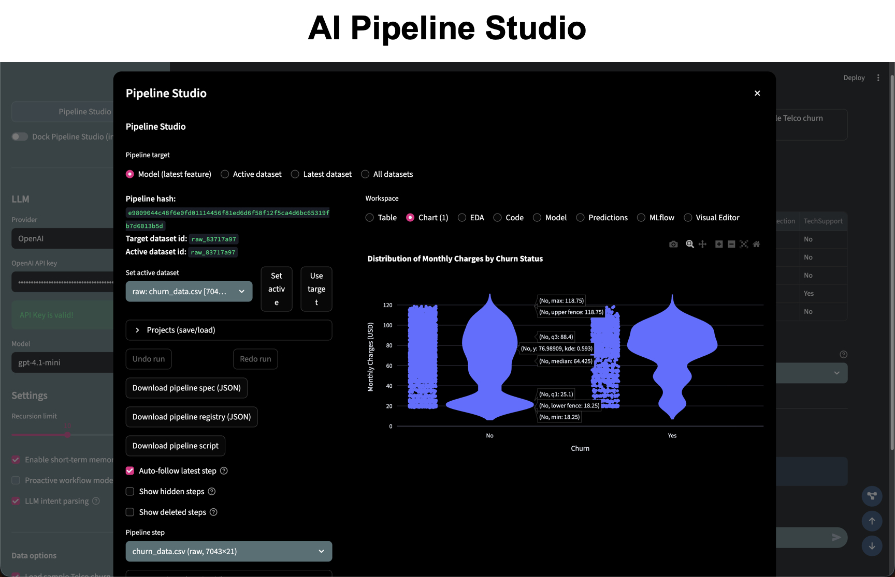

<div align="center">
  <a href="https://github.com/business-science/ai-data-science-team">
    <picture>
      
    </picture>
  </a>
</div>
<div align="center">
  <em>AI Data Science Team + AI Pipeline Studio</em>
</div>
<div align="center">
  <a href="https://pypi.python.org/pypi/ai-data-science-team"></a>
  <a href="https://github.com/business-science/ai-data-science-team"></a>
  <a href="https://github.com/business-science/ai-data-science-team/blob/main/LICENSE"></a>
  
</div>

# AI Data Science Team

AI Data Science Team is a Python library of specialized agents for common data science workflows, plus a flagship app: **AI Pipeline Studio**. The Studio turns your work into a visual, reproducible pipeline, while the AI team handles data loading, cleaning, visualization, and modeling.

**Status:** Beta. Breaking changes may occur until 0.1.0.

[**Please ⭐ us on GitHub (it takes 2 seconds and means a lot).**](https://github.com/business-science/ai-data-science-team)

## AI Pipeline Studio (Flagship App)

AI Pipeline Studio is the main example of the AI Data Science Team in action.



Highlights:
- Pipeline-first workspace: Visual Editor, Table, Chart, EDA, Code, Model, Predictions, MLflow
- Manual + AI steps with lineage and reproducible scripts
- Multi-dataset handling and merge workflows
- Project saves: metadata-only or full-data
- Storage footprint controls and rehydrate workflows

Run it:
```bash
streamlit run apps/ai-pipeline-studio-app/app.py
```

Full app docs: `apps/ai-pipeline-studio-app/README.md`

## Quickstart

### Requirements
- Python 3.10+
- OpenAI API key (or Ollama for local models)

### Install the app and library
Clone the repo and install in editable mode:
```bash
pip install -e .
```

### Run the AI Pipeline Studio app
```bash
streamlit run apps/ai-pipeline-studio-app/app.py
```

## Library Overview

The repository includes both the **AI Pipeline Studio** app and the underlying **AI Data Science Team** library. The library provides agent building blocks and multi-agent workflows for:
- Data loading and inspection
- Cleaning, wrangling, and feature engineering
- Visualization and EDA
- Modeling and evaluation (H2O + MLflow tools)
- SQL database interaction

### Agents (Snapshot)

Agent examples live in `examples/`. Notable agents:
- Data Loader Tools Agent
- Data Wrangling Agent
- Data Cleaning Agent
- Data Visualization Agent
- EDA Tools Agent
- Feature Engineering Agent
- SQL Database Agent
- H2O ML Agent
- MLflow Tools Agent
- Multi-agent workflows (e.g., Pandas Data Analyst, SQL Data Analyst)
- Supervisor Agent (oversees other agents)
- Custom tools for data science tasks
- Research Tools Agent: find public dataset sources and read web documentation

### Web research

Install the research extra (Python 3.10+) from this checkout:

```bash
pip install -e ".[research]"
```

`ResearchToolsAgent` uses [Parallel Search MCP](https://docs.parallel.ai/integrations/mcp/search-mcp)
for free web search and page fetching. Search uses Fast mode, with no Parallel
account or API key needed. Your chosen tool-calling language model is configured
as usual:

```python
from langchain_openai import ChatOpenAI
from ai_data_science_team import ResearchToolsAgent

llm = ChatOpenAI(model="gpt-4.1-mini")
agent = ResearchToolsAgent(model=llm)
agent.invoke_agent(
    "Find public US census population datasets. Read the source documentation "
    "and summarize their coverage and access requirements with source URLs."
)
print(agent.get_ai_message())
```

The model can call `web_search` and `web_fetch`; tool excerpts and URLs are
available in `agent.get_internal_messages()`. The agent finds and summarizes
sources. It does not download datasets, persist research files, or load results
into a database, and is not wired into AI Pipeline Studio's supervisor workflow.
Existing data-science agents keep their current tools.

To continue a conversation, provide a LangGraph checkpointer and reuse its
`configurable.thread_id`. Start a new thread for a new chat:

```python
from langgraph.checkpoint.memory import InMemorySaver

agent = ResearchToolsAgent(model=llm, checkpointer=InMemorySaver())
config = {"configurable": {"thread_id": "research-1"}}
agent.invoke_agent("Find the official pandas CSV loading guide.", config=config)
agent.invoke_agent("Read that guide and summarize missing-value options.", config=config)
```

Each checkpoint thread gets its own opaque conversation UUID, reused for search,
fetch and follow-ups. Without a checkpointer, each invocation is a new research
run. Keep checkpoints private and avoid sending private dataset contents or
credentials in web queries. Retrieved page text is untrusted evidence.

Use `search_enabled=False` to register no tools and prevent network research.
An explicit `tools=[...]` replaces the default provider; `tools=[]` also disables
tools. There is no automatic fallback after a configured tool fails. LangGraph's
`create_react_agent_kwargs={"interrupt_before": ["tools"]}` with a checkpointer
can pause for approval before tool execution. Resume the paused graph with
`agent.invoke(None, config=config)` after approval; a pause sends no MCP request.

For an explicit Parallel credential or a different timeout, pass a client:

```python
from ai_data_science_team.tools.web_research import ParallelSearchClient

client = ParallelSearchClient(
    headers={"Authorization": "Bearer <your-explicit-api-key>"}, timeout=30
)
agent = ResearchToolsAgent(model=llm, client=client)
```

No environment credentials are read by the search client. Anonymous usage has
service limits; quota and other tool errors are returned to the model without
changing conversation identity or switching providers. Each MCP call has a total
timeout (30 seconds by default). `await agent.ainvoke_agent(...)` uses the async
transport and propagates cancellation. Run the deterministic research tests with
`python -m unittest discover -s tests -v`.

## Apps

See all apps in `apps/`. Notable apps:
- AI Pipeline Studio: `apps/ai-pipeline-studio-app/`
- EDA Explorer App: `apps/exploratory-copilot-app/`
- Pandas Data Analyst App: `apps/pandas-data-analyst-app/`

## Use OpenAI

```python
from langchain_openai import ChatOpenAI
llm = ChatOpenAI(
    model_name="gpt-4.1-mini",
)
```

## Use Ollama (Local LLM)

```bash
ollama serve
ollama pull llama3.1:8b
```

```python
from langchain_ollama import ChatOllama

llm = ChatOllama(
    model="llama3.1:8b",
)
```

## Next-Gen AI Agentic Workshop

Want to learn how to build AI agents and AI apps for real data science workflows? Join my next‑gen AI workshop:
https://learn.business-science.io/ai-register
